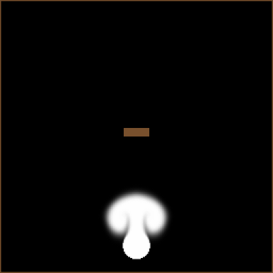
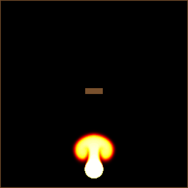

# 2D Smoke Simulation

| Smoke density | Temperature |
|---|---|
|  |  |

A 2D Eulerian smoke simulator written from scratch in C++20, following R. Bridson's *Fluid Simulation for Computer Graphics* [1]. Hot smoke is emitted at the bottom of a closed box, rises due to buoyancy, hits an obstacle and rolls up into two vortices while it cools down.

## Features

- **Staggered MAC grid**: velocity components on cell faces, scalars (smoke density, temperature, pressure) at cell centers
- **Semi-Lagrangian advection** [2] with RK2 backtracing and bilinear interpolation, for scalars and velocity
- **Pressure projection**: the pressure Poisson equation is solved with red-black Gauss–Seidel (warm-started from the previous step, stopped at a tolerance), then the pressure gradient is subtracted so the velocity becomes divergence-free
- **OpenMP**: all grid loops run in parallel, including both half sweeps of the red-black solver; the result does not depend on the number of threads
- **Solid walls and obstacles** from a voxel mask: normal velocity is zero on solid faces, and solid cells are left out of the pressure solve
- **Temperature-based buoyancy** [3]: smoke makes the fluid heavier, heat makes it lighter, and the temperature decays over time
- **Vorticity confinement** [3]: puts back small-scale swirls that the semi-Lagrangian advection smears out
- **Output**: color PPM frames of any grid (density, temperature, $u$, $v$, pressure, divergence), turned into PNG snapshots and GIFs with ffmpeg

## One time step

1. Set smoke density and temperature at the source cells
2. Advect density and temperature with the current velocity, then cool the temperature
3. Advect the velocity
4. Add buoyancy and vorticity confinement forces
5. Project: solve for pressure and make the velocity divergence-free

**Buoyancy and cooling** (ambient temperature 0, $s$ and $T$ averaged to the face):

$$v \leftarrow v + \Delta t\,(-\alpha s + \beta T), \qquad T \leftarrow T\,e^{-c\,\Delta t}$$

**Vorticity confinement**, with the vorticity computed at cell centers and the force averaged to the faces:

$$\omega = \frac{\partial v}{\partial x} - \frac{\partial u}{\partial y}, \qquad \mathbf{N} = \frac{\nabla|\omega|}{|\nabla|\omega||}, \qquad \mathbf{f} = \varepsilon\,h\,(\mathbf{N}\times\omega\,\hat{\mathbf{z}}) = \varepsilon\,h\,\omega\,(N_y,\,-N_x)$$

**Pressure projection.** Indices are $(i, j)$ = (row / $y$, column / $x$). For every fluid cell, with $n$ the number of fluid neighbours:

$$n\,p_{i,j} - \sum_{\text{fluid neighbours}} p = -\frac{\rho h^2}{\Delta t}\,(\nabla\cdot\mathbf{u})_{i,j}$$

and on every face between two fluid cells:

$$u_{i,j} \leftarrow u_{i,j} - \frac{\Delta t}{\rho h}\,(p_{i,j} - p_{i,j-1}), \qquad v_{i,j} \leftarrow v_{i,j} - \frac{\Delta t}{\rho h}\,(p_{i,j} - p_{i-1,j})$$

## Results

Scene in `main.cpp`: 256×256 grid, $\Delta t = h$, 2000 steps, $\alpha = 0.3$, $\beta = 1.5$, $c = 0.6$, $\varepsilon = 3$. The GIFs show every 8th step from step 250 on.

- Red-black Gauss–Seidel needs about 130 iterations per step on average, with a warm start and a tolerance of $10^{-5}$ on the pressure update. The 500-iteration limit is reached in only 2 of the 2000 steps, one of them the very first step, which starts from zero pressure.
- In the converged steps, $\max|\nabla\cdot\mathbf{u}| \le 10^{-2}$ after projection.

## Build and run

Requirements: a C++20 compiler, CMake ≥ 3.16, and ffmpeg in `PATH` for the PNG/GIF output.

```
cmake -S . -B build -G Ninja -DCMAKE_BUILD_TYPE=Release
cmake --build build
cd build
./smoke
```

Results are written to `tests/` (`density.gif`, `temperature.gif`, `start_*.png`, `end_*.png`); the raw frames are in `tests/frames/`.

## Code structure

| File | Contents |
|---|---|
| `Grid2D` | 2D grid storage, bilinear sampling for cell-centered, $u$ and $v$ layouts |
| `MAC2D` | staggered velocity field: divergence, velocity advection, solid mask, sources, buoyancy, vorticity confinement |
| `advection` | semi-Lagrangian advection of scalars |
| `projection` | pressure solve (red-black Gauss–Seidel) and velocity update |
| `output` | PPM export with colormaps, diagnostics (`maxAbs`, `sum`) |
| `recorder` | captures several grids every step, builds PNG snapshots and GIFs with ffmpeg |
| `main.cpp` | scene setup (walls, obstacle, source) and the time loop |

## Roadmap

- Preconditioned conjugate gradient with a MIC(0) preconditioner [1], compared with Gauss–Seidel (iterations, time, scaling with resolution)
- Higher resolution (512² and more)
- Less diffusive advection (MacCormack / BFECC)
- Water with a free surface

## References

1. R. Bridson. *Fluid Simulation for Computer Graphics*, 2nd ed. CRC Press, 2015.
2. J. Stam. Stable Fluids. *Proceedings of SIGGRAPH*, 1999.
3. R. Fedkiw, J. Stam, H. W. Jensen. Visual Simulation of Smoke. *Proceedings of SIGGRAPH*, 2001.
